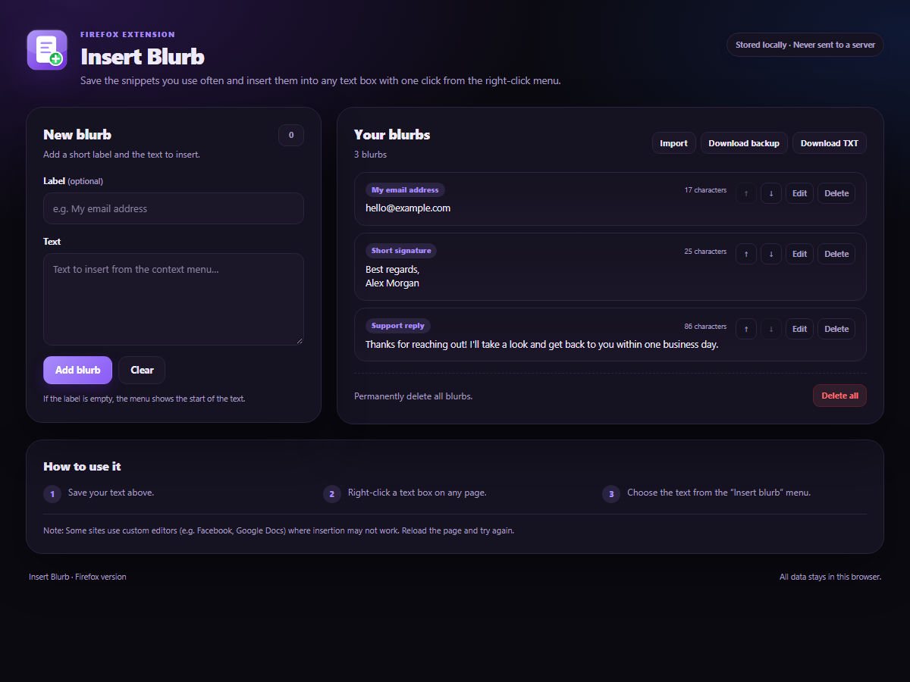

<p align="center">
  
</p>

<h1 align="center">Insert Blurb for Firefox</h1>

<p align="center">
  Save the text snippets you use most and insert them into any text field with one click from the right-click menu. Everything stays in your browser.
</p>

<p align="center">
  <a href="https://github.com/cengizkemec/insert-blurb-firefox/releases/latest"></a>
  
  
  
  
</p>

<p align="center">
  <strong>English</strong> · <a href="README.tr.md">Türkçe</a>
</p>

<p align="center">
  
  <br>
  <sub>English UI · <a href="docs/screenshots/options-tr.png">Türkçe arayüz</a></sub>
</p>

## Download

| Package | File |
| --- | --- |
| Firefox add-on (ZIP) | [`insert-blurb-firefox-1.0.0.zip`](https://github.com/cengizkemec/insert-blurb-firefox/releases/latest/download/insert-blurb-firefox-1.0.0.zip) |
| Firefox add-on (XPI, unsigned) | [`insert-blurb-firefox-1.0.0.xpi`](https://github.com/cengizkemec/insert-blurb-firefox/releases/latest/download/insert-blurb-firefox-1.0.0.xpi) |
| SHA-256 checksums | [`SHA256SUMS.txt`](https://github.com/cengizkemec/insert-blurb-firefox/releases/latest/download/SHA256SUMS.txt) |

> The builds are **unsigned**. See [Installation](#installation) for temporary loading and signing options.

## Features

- **One-click insertion** — right-click any editable field and choose a saved blurb from the **Insert blurb** submenu.
- **Labels and organization** — give each blurb a label, edit it, delete it, and reorder the menu without touching code.
- **Local-only storage** — blurbs are stored in Firefox's local extension storage, never uploaded or synced by the extension.
- **JSON backup and restore** — keep a full backup including labels, or move your blurbs to another Firefox profile.
- **Plain-text export/import** — export one blurb per line, or import a TXT file where every non-empty line becomes a blurb.
- **Duplicate detection** — imports skip snippets that already exist.
- **Sample snippets** — load three examples from the empty state and edit them.
- **Works in frames** — insertion is sent to the exact frame where the context menu was opened.
- **React-friendly fallback** — tries `execCommand("insertText")` first, then falls back to the native value setter plus an `input` event for controlled inputs.
- **Content-script recovery** — tabs that were open before installation are handled by injecting the content script on demand.
- **Error feedback** — a local notification is shown if a site refuses insertion.
- **English + Turkish UI** — follows the Firefox interface language; English is the fallback.
- **Dark and light themes** — follows the operating system / Firefox theme.
- **No tracking** — no analytics, no telemetry, no network requests.

## Installation

### Option A — temporary install (recommended for testing)

1. Download the ZIP and extract it.
2. Open `about:debugging#/runtime/this-firefox` in Firefox.
3. Click **Load Temporary Add-on…**.
4. Select `manifest.json` from the extracted folder.

The add-on stays installed until you restart Firefox. The settings page opens automatically on first install; you can reopen it from `about:addons` → **Insert Blurb** → **Preferences**, or from the **Manage blurbs…** menu item.

### Option B — permanent install

Firefox Release requires Mozilla-signed add-ons.

- Upload the ZIP to [addons.mozilla.org/developers](https://addons.mozilla.org/developers/) to have it signed, then install the signed XPI.
- On **Firefox Developer Edition** or **Firefox Nightly**, set `xpinstall.signatures.required` to `false` in `about:config` and install the unsigned XPI via `about:addons` → gear menu → **Install Add-on From File…**. This is intended for development only.

The `.xpi` in the release is the same build as the `.zip`, packaged for signing/testing.

## Usage

### Create a blurb

1. Open the settings page (`about:addons` → Insert Blurb → **Preferences**, or right-click **Insert blurb** → **Manage blurbs…**).
2. Enter an optional **label** (for example, “My email address”).
3. Enter the **text** to insert. Multi-line text is supported.
4. Press **Add blurb**.

### Insert a blurb

1. Click any text box, textarea, or contenteditable field.
2. Right-click to open the context menu.
3. Open **Insert blurb** and choose the snippet.

The text is inserted at the current cursor position / selection. If the selection was lost while the menu was open, the extension restores the last known caret position.

### Manage blurbs

- **Edit** opens a dialog for the label and text.
- **↑ / ↓** change the order in the context menu.
- **Delete** asks for a second click before removing the snippet.
- **Delete all** also uses a two-step confirmation.

### Backup and import

| Action | Format | Notes |
| --- | --- | --- |
| **Download backup** | JSON | Full backup with labels and timestamps. |
| **Download TXT** | TXT | One blurb per line; internal line breaks become spaces. |
| **Import** | JSON or TXT | JSON arrays, `{ "blurbs": [...] }`, or plain lines. Duplicates are skipped. |

The JSON backup is the recommended format if you care about labels or multi-line snippets. TXT is intentionally simple and convenient for lists of short snippets.

### Keyboard and menu behavior

- The submenu appears only for editable fields on `http://`, `https://`, and `file://` pages.
- The menu shows **“No blurbs yet”** when the list is empty; click it (or **Manage blurbs…**) to open the settings page.
- The settings page can be open in multiple tabs; changes are synced between them through storage events.

## How it works

This is a plain WebExtension with no build step and no third-party dependencies.

### Background script

- Reads blurbs from `browser.storage.local` and rebuilds the **Insert blurb** context menu on startup, install, and storage changes.
- On a menu click, it resolves the selected blurb, finds the target frame, and sends an `ib:insert` message.
- Before inserting, it pings the content script. If the content script is not present (for example, a tab that was open before installation), it calls `browser.tabs.executeScript()` and retries.
- Uses `browser.notifications` only when insertion fails.

### Content script

- Tracks the last editable element through `focusin` and `contextmenu` events, including elements inside shadow roots.
- Saves the caret/selection so it can be restored when the context menu temporarily takes focus.
- Supports `<input>` text types, `<textarea>`, and `contenteditable` hosts.
- Tries `document.execCommand("insertText")` first for native undo behavior, then falls back to the prototype's native `value` setter and an `InputEvent` for frameworks that track controlled inputs.
- Returns `{ ok, reason }` to the background script so the user can be notified when a site blocks insertion.

### Project structure

```text
insert-blurb-firefox/
├── manifest.json
├── background.js
├── content.js
├── options.html
├── options.css
├── options.js
├── icons/
│   ├── icon-16.png
│   ├── icon-32.png
│   ├── icon-48.png
│   ├── icon-96.png
│   └── icon-128.png
├── _locales/
│   ├── en/messages.json
│   └── tr/messages.json
├── docs/screenshots/
├── README.md
├── README.tr.md
├── PRIVACY.md
├── CHANGELOG.md
├── LICENSE
└── .gitignore
```

## Permissions

| Permission | Why it is needed |
| --- | --- |
| `storage` | Store your blurbs and settings locally. |
| `menus` | Build the **Insert blurb** right-click submenu. |
| `notifications` | Show a local notification when insertion fails. |
| `<all_urls>` | Run the content script that inserts text into the editable field you right-clicked. |

The `<all_urls>` permission is broad because the add-on must be able to insert text into any site where you use it. The extension does **not** transmit page content, browsing history, or your blurbs. It makes no network requests.

## Privacy

Everything is local. Blurbs are stored in Firefox's local extension storage and are delivered only to the tab where you trigger insertion. No analytics, telemetry, cloud sync, account, or remote code.

Read the full [privacy policy](PRIVACY.md). The manifest declares `data_collection_permissions.required = ["none"]`.

## Compatibility and limitations

- **Firefox desktop 109+** (Windows, macOS, Linux). Firefox for Android is not targeted.
- Some sites use custom editors that do not accept synthetic text insertion. Known examples include Facebook post composers, Google Docs, and canvas/Monaco-based editors. The extension shows an error notification instead of silently failing.
- Privileged pages (`about:`, `moz-extension:`, `view-source:`, AMO add-on pages, etc.) cannot run content scripts, so insertion is not available there.
- Password fields and number inputs are technically supported where the browser allows text insertion, but arbitrary text may be rejected by the site's validation.
- The menu is not shown on `data:` or browser-internal pages.
- If a site rerenders the field and destroys the saved selection, the extension falls back to the end of the field or the currently focused editable element.
- After installing the add-on, existing tabs may need a reload before insertion works on sites that already had a content script conflict. The background script attempts an on-demand injection first.

## Localization

The UI follows the Firefox interface language:

- `en` — English (default/fallback)
- `tr` — Turkish

To test another locale with `web-ext`:

```bash
web-ext run --pref intl.locale.requested=tr
```

To add a language, copy `_locales/en/messages.json` to `_locales/<code>/messages.json`, translate the values, and keep the keys unchanged.

## Development

### Requirements

- Firefox 109 or newer
- [web-ext](https://extensionworkshop.com/documentation/develop/getting-started-with-web-ext/) (optional, for linting/running)

### Lint and run

```bash
npx web-ext lint --source-dir .
npx web-ext run --source-dir .
```

The repository is checked with `web-ext lint` (0 errors) and automated smoke tests for the settings UI, background messaging, English/Turkish localization, and the content-script injection fallback.

### Build a release package

Include only runtime files (not `docs/`, README files, or development files):

```bash
zip -r insert-blurb-firefox-1.0.0.zip \
  manifest.json background.js content.js options.html options.css options.js \
  icons _locales LICENSE
```

Windows PowerShell:

```powershell
Compress-Archive -Path manifest.json,background.js,content.js,options.html,options.css,options.js,icons,_locales,LICENSE `
  -DestinationPath insert-blurb-firefox-1.0.0.zip
```

## Release assets

- `insert-blurb-firefox-1.0.0.zip` — installable source package for temporary loading and AMO signing.
- `insert-blurb-firefox-1.0.0.xpi` — same build, unsigned, for signing/testing.
- `SHA256SUMS.txt` — SHA-256 checksums for both files.

See [Releases](https://github.com/cengizkemec/insert-blurb-firefox/releases) for all versions.

## Disclaimer

This is an independent Firefox implementation inspired by the Chrome Web Store extension **Insert Blurb**. It is not affiliated with, endorsed by, or sponsored by the original publisher. All code and icons in this repository are original work. Product names and trademarks belong to their respective owners.

## License

[MIT](LICENSE) © 2026 Cengiz Kemeç
