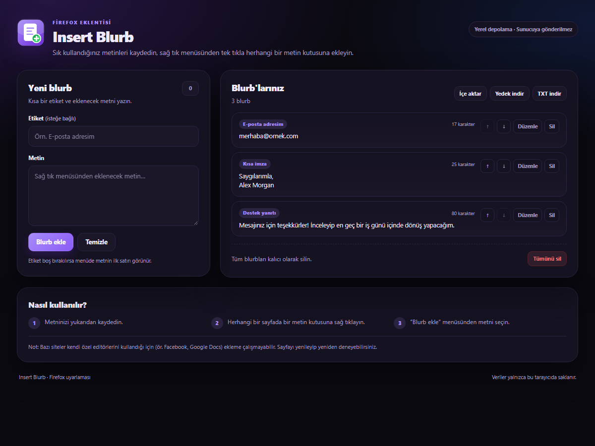

<p align="center">
  
</p>

<h1 align="center">Firefox için Insert Blurb</h1>

<p align="center">
  En sık kullandığınız metinleri kaydedin, sağ tık menüsünden tek tıkla herhangi bir metin kutusuna ekleyin. Her şey tarayıcınızda kalır.
</p>

<p align="center">
  <a href="https://github.com/cengizkemec/insert-blurb-firefox/releases/latest"></a>
  
  
  
  
</p>

<p align="center">
  <a href="README.md">English</a> · <strong>Türkçe</strong>
</p>

<p align="center">
  
  <br>
  <sub>Türkçe arayüz · <a href="docs/screenshots/options-en.png">English UI</a></sub>
</p>

## İndirme

| Paket | Dosya |
| --- | --- |
| Firefox eklentisi (ZIP) | [`insert-blurb-firefox-1.0.0.zip`](https://github.com/cengizkemec/insert-blurb-firefox/releases/latest/download/insert-blurb-firefox-1.0.0.zip) |
| Firefox eklentisi (XPI, imzasız) | [`insert-blurb-firefox-1.0.0.xpi`](https://github.com/cengizkemec/insert-blurb-firefox/releases/latest/download/insert-blurb-firefox-1.0.0.xpi) |
| SHA-256 özetleri | [`SHA256SUMS.txt`](https://github.com/cengizkemec/insert-blurb-firefox/releases/latest/download/SHA256SUMS.txt) |

> Paketler **imzasızdır**. Geçici yükleme ve imzalama seçenekleri için [Kurulum](#kurulum) bölümüne bakın.

## Özellikler

- **Tek tıkla ekleme** — herhangi bir düzenlenebilir alana sağ tıklayın ve **Blurb ekle** alt menüsünden kayıtlı metni seçin.
- **Etiketler ve düzen** — her blurb'a etiket verin, düzenleyin, silin ve menü sırasını değiştirin.
- **Yalnızca yerel depolama** — blurblar Firefox yerel eklenti depolamasında tutulur; eklenti tarafından hiçbir yere yüklenmez veya eşitlenmez.
- **JSON yedekleme/geri yükleme** — etiketler dahil tam yedek alın veya blurbları başka bir Firefox profiline taşıyın.
- **Düz metin dışa/içe aktarma** — her blurb tek satır olarak dışa aktarılır; TXT içe aktarmada boş olmayan her satır bir blurb olur.
- **Tekrar tespiti** — içe aktarmada zaten kayıtlı metinler atlanır.
- **Örnek blurblar** — boş durumdan üç örnek yükleyip düzenleyebilirsiniz.
- **Frame desteği** — ekleme, sağ tık menüsünün açıldığı tam frame'e gönderilir.
- **React uyumlu yedek yol** — önce `execCommand("insertText")` denenir; kontrollü input'larda yerel `value` setter + `input` olayına geçilir.
- **Content script kurtarma** — kurulumdan önce açılmış sekmeler için içerik betiği gerektiğinde enjekte edilir.
- **Hata geri bildirimi** — site eklemeye izin vermezse yerel bildirim gösterilir.
- **Türkçe + İngilizce arayüz** — Firefox arayüz dilini takip eder; varsayılan yedek dil İngilizcedir.
- **Koyu ve açık tema** — işletim sistemi / Firefox temasına uyum sağlar.
- **Takip yok** — analitik, telemetri veya ağ isteği yoktur.

## Kurulum

### Seçenek A — geçici kurulum (test için önerilir)

1. ZIP dosyasını indirip çıkarın.
2. Firefox'ta `about:debugging#/runtime/this-firefox` adresini açın.
3. **Load Temporary Add-on…** düğmesine tıklayın.
4. Çıkarılan klasördeki `manifest.json` dosyasını seçin.

Eklenti, Firefox yeniden başlatılana kadar yüklü kalır. İlk kurulumda ayarlar sayfası otomatik açılır; `about:addons` → **Insert Blurb** → **Preferences** veya **Blurb'ları yönet…** menüsünden yeniden açabilirsiniz.

### Seçenek B — kalıcı kurulum

Firefox Release sürümü Mozilla tarafından imzalanmış eklentileri kabul eder.

- ZIP dosyasını [addons.mozilla.org/developers](https://addons.mozilla.org/developers/) adresine yükleyip imzalatın ve imzalı XPI dosyasını kurun.
- **Firefox Developer Edition** veya **Firefox Nightly** kullanıyorsanız `about:config` üzerinden `xpinstall.signatures.required` ayarını `false` yapıp `about:addons` → dişli menüsü → **Install Add-on From File…** ile imzasız XPI dosyasını kurabilirsiniz. Bu yöntem yalnızca geliştirme içindir.

Sürümdeki `.xpi`, `.zip` ile aynı yapıdır; imzalama/test için paketlenmiştir.

## Kullanım

### Blurb oluşturma

1. Ayarlar sayfasını açın (`about:addons` → Insert Blurb → **Preferences** veya sağ tık **Blurb ekle** → **Blurb'ları yönet…**).
2. İsteğe bağlı bir **etiket** girin (ör. “E-posta adresim”).
3. Eklenecek **metni** girin. Çok satırlı metin desteklenir.
4. **Blurb ekle** düğmesine basın.

### Blurb ekleme

1. Bir metin kutusuna, textarea'ya veya contenteditable alana tıklayın.
2. Sağ tık menüsünü açın.
3. **Blurb ekle** alt menüsünü açıp metni seçin.

Metin, imlecin bulunduğu konuma / seçime eklenir. Menü açıkken seçim kaybolduysa eklenti son bilinen imleç konumunu geri yükler.

### Blurb yönetimi

- **Düzenle** bir etiket ve metin penceresi açar.
- **↑ / ↓** sağ tık menüsündeki sırayı değiştirir.
- **Sil** iki adımlı onay ister.
- **Tümünü sil** de iki adımlı onay kullanır.

### Yedekleme ve içe aktarma

| İşlem | Biçim | Notlar |
| --- | --- | --- |
| **Yedek indir** | JSON | Etiketler ve tarihler dahil tam yedek. |
| **TXT indir** | TXT | Her blurb tek satır; iç satır sonları boşluğa çevrilir. |
| **İçe aktar** | JSON veya TXT | JSON dizisi, `{ "blurbs": [...] }` veya düz satırlar. Tekrarlar atlanır. |

Etiketler veya çok satırlı blurblar önemliyse JSON yedeği önerilir. TXT, kısa blurb listeleri için basit ve pratiktir.

### Menü davranışı

- Alt menü yalnızca `http://`, `https://` ve `file://` sayfalarındaki düzenlenebilir alanlarda görünür.
- Liste boşsa menüde **“Henüz blurb eklenmedi”** yazar; tıklayınca (veya **Blurb'ları yönet…**) ayarlar sayfası açılır.
- Ayarlar sayfası birden çok sekmede açık olabilir; değişiklikler storage olaylarıyla sekmeler arasında eşitlenir.

## Nasıl çalışır?

Bu, derleme adımı ve üçüncü taraf bağımlılığı olmayan düz bir WebExtension'dır.

### Arka plan betiği

- Blurb'ları `browser.storage.local` üzerinden okur ve başlangıçta, kurulumda ve depolama değişikliklerinde **Blurb ekle** sağ tık menüsünü yeniden oluşturur.
- Menü tıklamasında seçilen blurb'u bulur, hedef frame'i belirler ve `ib:insert` mesajı gönderir.
- Eklemeden önce content script'e ping atar. Content script yoksa (ör. kurulumdan önce açılmış sekme) `browser.tabs.executeScript()` ile enjekte edip yeniden dener.
- `browser.notifications` yalnızca ekleme başarısız olduğunda kullanılır.

### Content script

- `focusin` ve `contextmenu` olaylarıyla son düzenlenebilir öğeyi izler; shadow root içindeki öğeleri de kapsar.
- Sağ tık menüsü odağı aldığında geri yüklemek için imleç/seçim konumunu saklar.
- `<input>` metin türlerini, `<textarea>` ve `contenteditable` alanları destekler.
- Önce yerel geri alma davranışı için `document.execCommand("insertText")` dener; olmazsa kontrollü input kullanan framework'ler için prototipteki yerel `value` setter ve `InputEvent` yoluna geçer.
- Arka plan betiğine `{ ok, reason }` döndürür; site eklemeyi engellerse kullanıcıya bildirim gösterilir.

### Proje yapısı

```text
insert-blurb-firefox/
├── manifest.json
├── background.js
├── content.js
├── options.html
├── options.css
├── options.js
├── icons/
│   ├── icon-16.png
│   ├── icon-32.png
│   ├── icon-48.png
│   ├── icon-96.png
│   └── icon-128.png
├── _locales/
│   ├── en/messages.json
│   └── tr/messages.json
├── docs/screenshots/
├── README.md
├── README.tr.md
├── PRIVACY.md
├── CHANGELOG.md
├── LICENSE
└── .gitignore
```

## İzinler

| İzin | Neden gerekli? |
| --- | --- |
| `storage` | Blurb'ları ve ayarları yerel olarak saklamak. |
| `menus` | **Blurb ekle** sağ tık alt menüsünü oluşturmak. |
| `notifications` | Ekleme başarısız olduğunda yerel bildirim göstermek. |
| `<all_urls>` | Sağ tıkladığınız düzenlenebilir alana metin ekleyen content script'i çalıştırmak. |

`<all_urls>` izni geniştir; çünkü eklentinin kullanıldığı her sitede metin ekleyebilmesi gerekir. Eklenti sayfa içeriğini, tarama geçmişini veya blurblarınızı **iletmez**; hiçbir ağ isteği göndermez.

## Gizlilik

Her şey yereldir. Blurb'lar Firefox yerel eklenti depolamasında saklanır ve yalnızca eklemeyi tetiklediğiniz sekmeye iletilir. Analitik, telemetri, bulut eşitleme, hesap veya uzaktan kod yoktur.

Tam [gizlilik politikasını](PRIVACY.md) okuyun. Manifest `data_collection_permissions.required = ["none"]` bildirir.

## Uyumluluk ve sınırlamalar

- **Firefox masaüstü 109+** (Windows, macOS, Linux). Firefox for Android hedeflenmez.
- Bazı siteler sentetik metin eklemeyi kabul etmeyen özel editörler kullanır. Bilinen örnekler: Facebook gönderi editörü, Google Docs ve canvas/Monaco tabanlı editörler. Eklenti sessizce başarısız olmak yerine hata bildirimi gösterir.
- Ayrıcalıklı sayfalarda (`about:`, `moz-extension:`, `view-source:`, AMO eklenti sayfaları vb.) content script çalışamaz; ekleme yapılamaz.
- Parola alanları ve sayı input'ları tarayıcının izin verdiği ölçüde teknik olarak desteklenir; ancak site doğrulaması rastgele metni reddedebilir.
- `data:` ve tarayıcı içi sayfalarda menü gösterilmez.
- Site alanı yeniden oluşturup kayıtlı seçimi yok ederse eklenti, alanın sonuna veya o anda odaklı düzenlenebilir öğeye geri döner.
- Kurulumdan sonra bazı mevcut sekmelerde content script çakışması olursa sayfayı yenilemek gerekebilir. Arka plan betiği önce isteğe bağlı enjeksiyon dener.

## Yerelleştirme

Arayüz, Firefox arayüz dilini takip eder:

- `en` — İngilizce (varsayılan/yedek)
- `tr` — Türkçe

`web-ext` ile başka bir dili test etmek için:

```bash
web-ext run --pref intl.locale.requested=tr
```

Yeni bir dil eklemek için `_locales/en/messages.json` dosyasını `_locales/<kod>/messages.json` olarak kopyalayın, değerleri çevirin ve anahtarları değiştirmeyin.

## Geliştirme

### Gereksinimler

- Firefox 109 veya üzeri
- [web-ext](https://extensionworkshop.com/documentation/develop/getting-started-with-web-ext/) (isteğe bağlı; lint ve çalıştırma için)

### Lint ve çalıştırma

```bash
npx web-ext lint --source-dir .
npx web-ext run --source-dir .
```

Depo `web-ext lint` ile (0 hata) ve ayarlar arayüzü, arka plan mesajlaşması, Türkçe/İngilizce yerelleştirme ve content script enjeksiyon yedek yolu için otomatik smoke testleriyle kontrol edilmiştir.

### Sürüm paketi oluşturma

Yalnızca çalışma zamanı dosyalarını ekleyin (`docs/`, README dosyaları ve geliştirme dosyaları hariç):

```bash
zip -r insert-blurb-firefox-1.0.0.zip \
  manifest.json background.js content.js options.html options.css options.js \
  icons _locales LICENSE
```

Windows PowerShell:

```powershell
Compress-Archive -Path manifest.json,background.js,content.js,options.html,options.css,options.js,icons,_locales,LICENSE `
  -DestinationPath insert-blurb-firefox-1.0.0.zip
```

## Sürüm dosyaları

- `insert-blurb-firefox-1.0.0.zip` — geçici yükleme ve AMO imzalama için kaynak paketi.
- `insert-blurb-firefox-1.0.0.xpi` — aynı yapı, imzasız; imzalama/test için.
- `SHA256SUMS.txt` — iki dosyanın SHA-256 özetleri.

Tüm sürümler: [Releases](https://github.com/cengizkemec/insert-blurb-firefox/releases).

## Sorumluluk reddi

Bu proje, Chrome Web Store'daki **Insert Blurb** eklentisinden ilham alan bağımsız bir Firefox uygulamasıdır. Orijinal yayıncı ile bağlantılı değildir, onun tarafından desteklenmez veya sponsor edilmez. Bu depodaki tüm kod ve simgeler özgün çalışmadır. Ürün adları ve ticari markalar ilgili sahiplerine aittir.

## Lisans

[MIT](LICENSE) © 2026 Cengiz Kemeç
